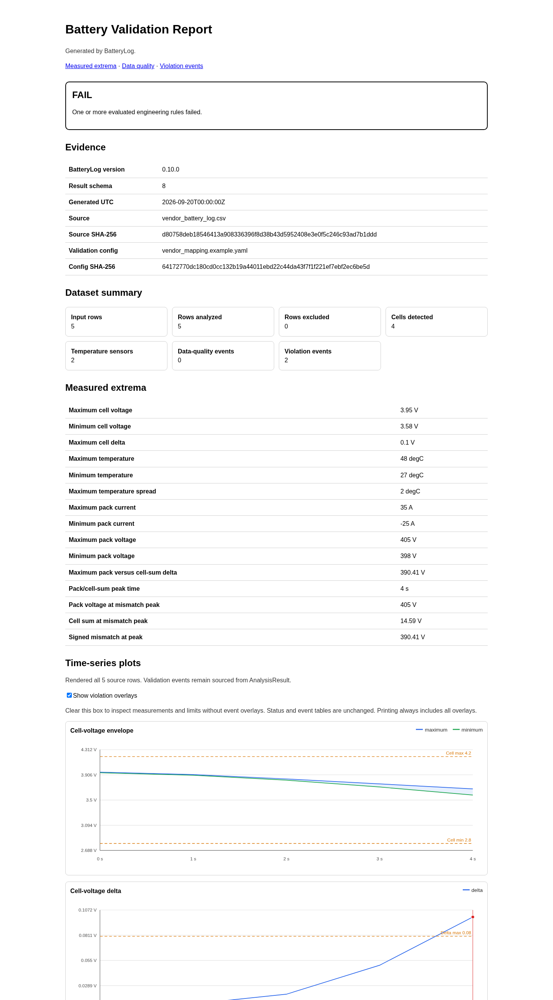

# BatteryLog

> **Development branch:** one free Apache-2.0 package. The last published release is v0.10.0; the workflows below target the unreleased 0.11.0.dev0 source tree. See [licensing/package scope](docs/LICENSING.md).

BatteryLog is an open-source engineering toolkit for reproducible EV battery/BMS log validation from the command line or Python.

**Current release:** `v0.10.0`; see [`CHANGELOG.md`](CHANGELOG.md) for changes.

**Development:** 0.11.0.dev0 combines desktop single/batch analysis, opt-in temporal
checks, offline CAN preparation/replay, and precharge JSON/HTML observations in one
installation. Experimental workflows retain their documented qualification limits.
There is no separate Research subscription, companion wheel or evaluation license.

**Current verification:** Local checks on 23 October 2026: native Windows/Python 3.13.14 has 3,268 passing tests and 2 platform-specific skips, with 96.63% Core coverage. All 45 native Tk tests run without skips. The same normalization fix passed 3,270 tests on Linux/Python 3.14.7 with 96.46% Core coverage. Fresh wheel/sdist installs and synthetic large-file checks pass. Hosted required checks remain pending; this is not a release. See [qualification scope](docs/QUALIFICATION_2026_10_23.md).

**Status:** **Pre-1.0 engineering beta.** The validation core is extensively tested; APIs and supported workflows may still evolve before 1.0.

> **Historical real-data check:** BatteryLog v0.9.1 was exercised on **30.2 million physical battery-pack records**, producing **90.6 million branch-row analyses** across **1,230 runs**, with **1,230/1,230 independent pack/cell-sum parity checks**.

## First evaluation: three actions (0.11 development)

The easiest way to see a complete analysis **without configuring your own BMS signals**
is the desktop demo. This GUI is available in the **development checkout**, not the
published v0.10.0 release or a standalone installer. Python with Tk support is required.

```sh
python -m pip install -e .
python -m batterylog.desktop
```

1. Select **Try demo…**, then choose an existing folder for the synthetic input and output.
2. Select **Run analysis**.
3. Select **Open report** and inspect the two deliberately triggered rule violations.

**FAIL in this demo is expected** and means the configured checks found violations;
it does not mean the application crashed. For your own CSV/MDF/MF4 file, choose a
measurement, optionally **Inspect input**, choose the YAML validation configuration
and an output folder, then run. Without engineering limits, a valid measurement
usually yields metrics and **NOT_EVALUATED**, not a safety **PASS**. Invalid data can
still cause an error or a data-quality failure.

See [desktop setup, capabilities and limits](docs/DESKTOP_LAUNCHER.md) for Tk/MF4
requirements and [example configurations](examples/validation.example.yaml).
All demo limits are illustrative; obtain production criteria from your test plan.

## What it does

- Streams large CSV logs with bounded source-row chunks
- Optionally ingests ASAM MDF/MF4 measurement files
- Maps vendor signal names into a canonical battery model
- Inspects channel metadata and converts explicitly declared source units to canonical CSV
- Analyzes directories with per-file evidence and a CSV summary
- Applies explicit voltage, temperature, current, imbalance, spread, and pack-voltage plausibility rules
- Fails closed on invalid required measurement data
- Groups failing samples into structured violation events with peak evidence
- Emits versioned JSON results with `PASS`, `FAIL`, or `NOT_EVALUATED`
- Generates self-contained HTML evidence reports with deterministic inline SVG plots
- Records SHA-256 input/config provenance
- Includes experimental offline CAN preparation/replay and source-linked precharge HTML
- Runs Linux/Windows verification and checked wheel/sdist installation

BatteryLog deliberately ships **no universal battery safety thresholds**. Limits must come from the tested cell/pack specification, BMS strategy, operating state, and validation plan.

## Experimental offline workflows (0.11 development)

Install the same project once, adding only the backends you need:

```sh
python -m pip install -e .          # CSV, desktop, precharge HTML and replay
python -m pip install -e ".[can]"  # DBC-backed CAN workflows
python -m pip install -e ".[mf4]"  # MDF/MF4 support
batterylog experimental --help
```

A supplied candidate wheel/sdist can be installed with pip instead of a checkout;
there is no second product or add-on to install. Public v0.10.0 does not contain
these experimental commands. In a fresh environment, use the reviewed candidate
artifact or this checkout, rather than assuming a released package has them.

```sh
mkdir results
batterylog experimental precharge --csv capture.csv --context capture.context.json --output-dir results/precharge
batterylog experimental replay capture.log results/replay
batterylog experimental can --log capture.log --dbc vehicle.dbc --profile mapping.json --config limits.yaml --output-dir results/can
```

Precharge writes index.html, report.html, review.json and manifest.json. It reports
observations and incomplete coverage, not a calibrated physical PASS.
Replay uses recorded files only; it neither opens an adapter nor transmits CAN.
CAN preparation requires an explicit source profile, declared channel ages and
caller-supplied DBC. Held rows are not simultaneous sensor acquisitions; temporal
models and unqualified pack/cell-sum comparisons are rejected in this workflow.

See [operator contract](docs/RESEARCH_OPERATOR_2026_10_17.md),
[precharge input](docs/RESEARCH_PRECHARGE_FILE_REVIEW_2026_10_14.md),
[replay](docs/RESEARCH_CAN_OFFLINE_REPLAY_2026_10_17.md) and
[measurement contract](docs/MEASUREMENT_CONTRACT.md).

## Quick start

From a checkout:

```powershell
python -m venv .venv
.\.venv\Scripts\python.exe -m pip install -e .
```

For MDF/MF4 support:

```powershell
.\.venv\Scripts\python.exe -m pip install -e ".[mf4]"
```

Compute metrics without activating engineering rules:

```powershell
.\.venv\Scripts\batterylog.exe examples\sample_battery_log.csv
```

Run validation from YAML and generate JSON + HTML evidence:

```powershell
.\.venv\Scripts\batterylog.exe examples\sample_battery_log.csv `
  --config examples\validation.example.yaml `
  --json-out battery-result.json `
  --report battery-report.html
```

Completed analyses also emit canonical JSON to stdout.

Analyze a directory with per-file JSON/HTML and one CSV summary:

```sh
batterylog measurements --batch --config validation.yaml --output-dir results/run-001
```

See [batch analysis](docs/BATCH_ANALYSIS.md) for discovery, output layout and error handling.

List channels and check their configured selection before analysis:

```sh
batterylog capture.mf4 --inspect --config validation.yaml
```

See [input inspection](docs/INPUT_INSPECTION.md) for metadata scope and exit codes.
An `OK` inventory checks channel metadata only; engineering analysis still needs to run.

Prepare a new canonical CSV from explicitly declared source units:

```sh
batterylog source.csv --normalize --time-unit ms --cell-voltage-unit mV \
  --temperature-unit K --output-dir prepared/run-001
```

See [unit normalization](docs/UNIT_NORMALIZATION.md) for supported units, conversion evidence
and the subsequent analysis step.

## Input model

Canonical CSV input starts with a numeric, non-decreasing timestamp plus indexed cell-voltage and temperature channels:

```csv
timestamp_s,pack_current_a,pack_voltage_v,cell_1_v,cell_2_v,temp_1_c,temp_2_c
0,-25,7.89,3.95,3.94,28,27
1,35,7.26,3.68,3.58,48,46
```

Required canonical signals:

- `timestamp_s`
- one or more `cell_<n>_v` channels
- one or more `temp_<n>_c` channels

Optional scalar signals:

- `pack_current_a`
- `pack_voltage_v`

Vendor-specific names can be selected with explicit regex-based YAML signal mapping instead of renaming source files.

The pack-voltage/cell-sum rule must only be enabled when the selected cells represent the **complete series stack** on the same meaningful time basis as the pack-voltage measurement. Parallel branches, omitted cells, multiplexed channels, and forward-filled/ZOH data require topology-aware preparation.

Full input, mapping, MF4, data-quality, and comparison semantics are in [`docs/REFERENCE.md`](docs/REFERENCE.md).

## Validation rules

| Rule | Purpose |
| --- | --- |
| `CELL_OVERVOLTAGE` | cell voltage above configured maximum |
| `CELL_UNDERVOLTAGE` | cell voltage below configured minimum |
| `CELL_IMBALANCE_HIGH` | row-wise cell-voltage spread above limit |
| `TEMPERATURE_HIGH` | temperature above configured maximum |
| `TEMPERATURE_LOW` | temperature below configured minimum |
| `TEMPERATURE_SPREAD_HIGH` | row-wise temperature spread above limit |
| `PACK_CHARGE_OVERCURRENT` | charge-current magnitude above configured limit |
| `PACK_DISCHARGE_OVERCURRENT` | discharge-current magnitude above configured limit |
| `PACK_VOLTAGE_CELL_SUM_MISMATCH` | absolute pack voltage vs. complete series-cell sum above tolerance |

Rules are opt-in through numeric limits. With no active rule, BatteryLog computes metrics and returns `NOT_EVALUATED` instead of pretending that the log passed validation.

Example configuration:

```yaml
schema_version: 6

limits:
  cell_voltage:
    min_v: 2.8
    max_v: 4.2
    max_delta_v: 0.08
  temperature:
    min_c: -20
    max_c: 55
    max_spread_c: 12

event_detection:
  max_gap_s: 2.0

data_quality:
  mode: strict
```

The values above are illustrative, not recommended production limits.

## Results and evidence

Each completed analysis reports:

- measured extrema and row accounting
- effective limits and evaluated rules
- structured violation events with start/end/peak timestamps
- implicated signals, sample count, duration, and peak excursion
- signal-mapping metadata
- comparison policy
- result-schema version
- optional structured data-quality evidence

Current machine-readable result schema: **v8**. Historical frozen result schemas remain packaged for compatibility.

Validation status:

| Status | Meaning |
| --- | --- |
| `NOT_EVALUATED` | no engineering rule was active and no structured data-quality defect was recorded |
| `PASS` | at least one rule was evaluated and no rule/data-quality failure occurred |
| `FAIL` | at least one engineering-rule violation and/or structured data-quality defect occurred |

CLI exit codes are `0=PASS`, `1=FAIL`, `2=usage error`, `3=NOT_EVALUATED`, `4=runtime/input/output error`.

## HTML report

Reports are self-contained and include validation status, extrema, limits, violation evidence, provenance, and deterministic inline SVG plots.



Plot reduction is evidence-preserving: retained geometry is separate from PASS/FAIL evaluation, and structured violation intervals/peaks remain sourced from the analysis result.

See [`docs/REPORT_SERIES.md`](docs/REPORT_SERIES.md) for the plotting/downsampling contract.

## Real-data validation

BatteryLog v0.9.1 was exercised against the public CORA experimental 3P12S battery-pack dataset (DOI `10.34810/data2395`).

| Campaign metric | Result |
| --- | ---: |
| Parquet cycle files | 410 |
| Unique physical source rows | 30,187,165 |
| Branch-row analyses | 90,561,495 |
| BatteryLog streaming runs | 1,230 |
| Runtime errors | 0 |
| Independent direct-comparison parity | 1,230 / 1,230 |

The campaign used a **0.15 V illustrative software-validation threshold** for the pack/cell-sum rule; it is not presented as a universal engineering tolerance. The source also uses asynchronous acquisition with zero-order hold, which materially affects row-level interpretation.

Exact dataset hash, topology mapping, methodology, performance, limitations, and reproduction steps are in [`docs/REAL_DATA_VALIDATION.md`](docs/REAL_DATA_VALIDATION.md).

## Python API

```python
from batterylog import ValidationLimits, analyze_battery_log

limits = ValidationLimits(
    cell_min_v=2.8,
    cell_max_v=4.2,
    imbalance_max_v=0.08,
    temperature_max_c=55,
)

result = analyze_battery_log("test.csv", limits=limits)
print(result["validation_status"])
```

See [`docs/REFERENCE.md`](docs/REFERENCE.md) for configuration loading, event semantics, mapping, and compatibility details.

## Documentation

| Document | Contents |
| --- | --- |
| [`docs/REFERENCE.md`](docs/REFERENCE.md) | CLI, config, canonical signals, MF4, schemas, event and engineering semantics |
| [`docs/REAL_DATA_VALIDATION.md`](docs/REAL_DATA_VALIDATION.md) | CORA real-data campaign and reproduction |
| [`docs/RESULT_SCHEMA_VERSIONING.md`](docs/RESULT_SCHEMA_VERSIONING.md) | result-contract versioning policy |
| [`docs/REPORT_SERIES.md`](docs/REPORT_SERIES.md) | report-series and downsampling contract |
| [`docs/THREAT_MODEL.md`](docs/THREAT_MODEL.md) | provenance and trust boundaries |
| [`docs/MF4_BENCHMARK.md`](docs/MF4_BENCHMARK.md) | MF4 memory/performance characterization |
| [`docs/RELEASING.md`](docs/RELEASING.md) | release procedure |

## Development

```powershell
.\.venv\Scripts\python.exe -m pip install -e ".[dev,mf4]"
.\.venv\Scripts\python.exe -m ruff format --check .
.\.venv\Scripts\python.exe -m ruff check .
.\.venv\Scripts\python.exe -m pip check
.\.venv\Scripts\python.exe -m pytest -q --cov=batterylog --cov-fail-under=95
```

Public BatteryLog CI runs the complete required matrix and covers Linux, Windows,
supported Python versions, optional MF4/CAN contracts and package installation.
Linux full suites require real Tk widgets under Xvfb; Windows requires a native
graphical session. A skipped required job cannot pass the final CI gate. Tagged
releases retain exact version checks and verified artifact publication.

## License and citation

BatteryLog is licensed under the [Apache License 2.0](LICENSE). Commercial, internal, research, and educational use are welcome subject to the license terms.

Citation metadata is available in [`CITATION.cff`](CITATION.cff); attribution information is recorded in [`NOTICE`](NOTICE).

Tagged releases publish wheel/sdist artifacts plus SHA-256 checksums through [GitHub Releases](https://github.com/CANWECAN/BatteryLog/releases).

The opt-in contactor response check compares observed command transitions with
independent binary feedback. Try `examples/contactor_response_demo.csv` with
`examples/contactor_response.example.yaml`; see [the observation contract](docs/FAILURE_MODELS.md#contactor-response-contract).


The opt-in precharge-current check measures the magnitude drop from an observed
phase activation to an engineer-selected checkpoint. Try `examples/precharge_current_demo.csv`
with `examples/precharge_current.example.yaml`; see [the observation contract](docs/FAILURE_MODELS.md#precharge-current-contract).
