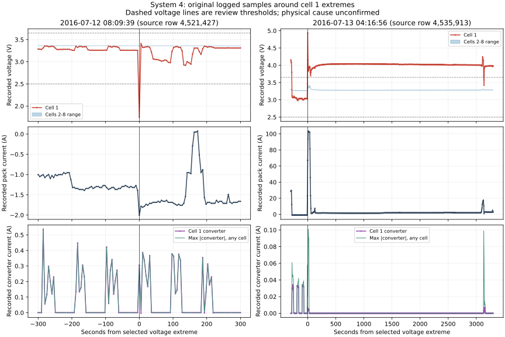

# Source episode review — 2026-10-13

Baseline: `d00bd63c0528e1caa88582772cb35b0723e9ec69`.
Branch: `audit/cloud-balancing-spread-20261012`.

## Outcome

Cell 1 remains the main review candidate after separating extreme logged-current
pairs and large pack/cell-sum discrepancies. Its July low-voltage dip is a single
sample surrounded by much higher readings, whereas the July high-voltage peak
starts a long run of above-threshold samples. These are different recorded patterns.
The evidence supports prioritizing cell 1's measurement/cell/connection chain for
investigation. It does not identify the physical cause or authenticate a fault.

## Source and independent cross-check

Schaeffer, Joachim; Lenz, Eric; Gulla, Duncan; Bazant, Martin; Braatz, Richard D.;
Findeisen, Rolf. Dataset DOI
[10.5281/zenodo.13715694](https://doi.org/10.5281/zenodo.13715694),
member `field_data/data_sys_4.csv`, license **CC BY-NC 4.0**. This is internal
research characterization; raw data files are not committed. Source hash:

`f4a7861b72b273f7a78f5fc2e1f965c9c631bc579ea03099d14b10f82df003b9`

The related published article, DOI
[10.1016/j.xcrp.2024.102258](https://doi.org/10.1016/j.xcrp.2024.102258),
was consulted through the
[authors' MIT-hosted published PDF](https://web.mit.edu/braatzgroup/Schaeffer_CellRepPhysSci_2024.pdf).
**Table 2, system 4, identifies cell 1 as showing an upward resistance trend while
other cells have fairly constant resistances.** This agrees with our localization,
but comes from a different, selected-data GP analysis; we did not reproduce that
model or its resistance estimates.

The article explicitly discusses >1,000 A current outliers for systems 3, 4 and 16
with unresolved causes (p. 4). It also explains that the hardware was unavailable
for mechanical inspection, and resistance patterns cannot distinguish cell
degradation from connection problems (p. 10). Specific fault types and times are
unknown, so fault detection was not carried out in the article (p. 14).

Our new array calculation read all **4,695,793 original source rows**, including
eight converter currents. No clipping, smoothing, resampling, sorting or row
removal was applied. It reproduced the prior independent CSV observer exactly
in aggregate: **4,037 observations**, distributed as cell 1: 3,958; cell 2: 3;
cell 3: 3; cell 8: 73; all remaining cells: 0.

There are **4,294,639 eligible adjacent pairs** under the same 0.05 V relative-step
and 60 s gap review parameters. Duplicate, backward and oversized time steps are
ineligible; the source clock reversal is not bridged. This independent context
calculation does not change the production loader's strict rejection of the intact
backward-time file.

## Sensitivity to logged-current and sum-consistency context

Each condition tests **both original adjacent endpoints**. No new pair is formed
across removed samples. All observations remain in the primary result. The strata
are illustrative sensitivity probes, not calibrated current or safety limits.

| Review subset | Eligible pairs | Observations | Cell 1 observations | Cell 1 share |
| --- | ---: | ---: | ---: | ---: |
| All eligible pairs | 4,294,639 | 4,037 | 3,958 | 98.04% |
| Both absolute currents <=50 A | 4,246,511 | 2,935 | 2,933 | 99.93% |
| Both absolute currents <=100 A | 4,272,568 | 3,286 | 3,276 | 99.70% |
| Both absolute currents <=500 A | 4,294,615 | 4,032 | 3,955 | 98.09% |
| Both absolute currents <=1,000 A | 4,294,622 | 4,032 | 3,955 | 98.09% |
| Both absolute currents <=100 A AND both absolute pack/sum errors <=0.15 V | 4,272,552 | 3,277 | 3,273 | 99.88% |

Thus, the cell 1 localization is not solely a consequence of the extreme logged
current values. Restriction is not proof that the retained measurements are
physically correct or independent.

Of cell 1's 3,958 observations:

- 3,955 have pack/cell-sum discrepancy <=0.15 V at both endpoints.
- 1,638 have all eight recorded converter currents exactly zero at both endpoints.
- 1,306 have at least one converter exceeding 0.1 A in magnitude at an endpoint;
  1,039 have that condition specifically on cell 1.
- 1,157 have absolute pack-current change <=1 A.

These associations do not establish a balancing state or a balancing cause.
Converter-current magnitude alone cannot authenticate the BMS mode. In particular,
recorded converter activity cannot explain every flagged pair.

## Timing and counting

Cell 1 observations concentrate in June–July 2016: 414 and 3,541, respectively.
Those months contain 340,798 and 302,453 eligible pairs, or approximately **1.215
and 11.708 cell 1 observations per 1,000 eligible pairs**. Sampling density and
operating conditions vary, so this is not an age-adjusted degradation estimate.
There were also three cell 1 observations in July 2015.

Grouping cell 1 observations by 5/30/60 s proximity within uninterrupted eligible
pair blocks yields **2,180 / 1,081 / 780 review groups**. These arbitrary group
counts are not incident counts or physical fault counts. Multiple oscillations and
reversals can belong to one physical episode; multiple causes may also be present.

## Three contrasting source episodes

All row numbers below are 1-based **data rows**, not CSV physical lines. Source
timestamps are reported as recorded, without assigning a timezone.

| Selected source row | Timestamp | Cell 1 | Pack current | Pack minus cell sum | Cell 1 converter |
| --- | --- | ---: | ---: | ---: | ---: |
| 3,802,126 | 2016-02-11 14:53:53 | 2.800 V | 0.000 A | +4.668 V | -0.003 A |
| 4,521,427 | 2016-07-12 08:09:39 | 1.752 V | -2.004 A | -0.106 V | +0.305 A |
| 4,535,913 | 2016-07-13 04:16:56 | 4.934 V | +67.144 A | +0.072 V | +0.005 A |

**February common-mode discrepancy.** All eight cells fall to roughly 2.8 V,
while pack voltage remains 27.038 V. The previous source record has exactly the
same timestamp and near-3.38 V cells. The +/-300 s window has two duplicate pairs
and two gaps >60 s. This is a source consistency/timing concern; the pack-sum rule
adds evidence that a peer-relative observer cannot provide. It cannot establish
which channel or record is physically wrong.

**July 12 dip.** Cell 1 goes from **3.255 to 1.752 to 3.410 V** in three consecutive
5 s records, while cells 2–8 remain near 3.36 V. Only one sample falls below the
illustrative 2.5 V threshold. The +/-300 s window has 119 rows, no duplicate or
oversized gaps, maximum absolute pack current 2.004 A, and maximum absolute
pack/sum error 0.106 V. Converter current changes concurrently, but a causal
explanation cannot be extracted from this coincidence. A single sampled dip does
not establish how long the physical voltage was low.

**July 13 elevated run.** The 4.934 V peak is followed by **629 consecutive
above-3.65 V samples**, source rows 4,535,913–4,536,541, from **04:16:56 to 05:09:09**.
The sampled span is **3,133 s (52 min 13 s)**. Cell 1 ranges 3.692–4.934 V in this
run; recorded pack current is +1.368 to +103.453 A, maximum absolute pack/sum
error is 0.072 V, and maximum absolute cell 1 converter current is only 0.005 A.
The next record, 5 s later, reads 3.424 V; higher values appear again afterward.
This is the first bounded sampled run around the selected peak, not total episode
duration. Large recorded cell 1 balancing currents do not account for this run.



The left figure spans +/-300 s; the right spans -300 to +3,300 s around its
selected extreme. Every plotted measurement in those ranges is retained. Lines
connect samples for readability and do not reconstruct unobserved behavior.
Shared adjacent-cell temperature readings do not establish local cell 1 heating.

## What this changes for BatteryLog

The arithmetic and chunk-parity findings still stand. This follow-up strengthens
cell 1 localization, and shows why step counts, sampled duration, pack consistency
and converter context should be interpreted together. It does **not** justify a
new production fault label, automatic current clipping, an inferred balancing flag,
or a claim that the cell itself rather than its connection/sensing chain failed.

The next physical validation gate requires independently labeled/synchronized
measurements or hardware inspection/calibration information. Until then, these
results remain review observations. Dataset-wide false-positive rates, diagnostic
accuracy, early-warning lead time and safety guarantees are not measured here.

## Reproduction and verification

```bash
python -m batterylog_research.field_episode_review \
  field_data/data_sys_4.csv \
  batterylog_research/field_episode_summary_20261013.json \
  --figure batterylog_research/field_episode_context_20261013.svg
```

This forensic harness intentionally uses a full dataframe; it is not a streaming
memory benchmark. The figure option requires matplotlib in the research
environment; no production dependency was added. The SVG is the committed figure;
its generated PNG is a transient visual-check rendering.

Four new tests cover agreement with the CSV observer at the threshold, duplicates
and gaps; split-population consensus and backward-time censoring; group continuity;
and sampled-run boundaries. Combined focused suite: **49 passed**. Whole-tree
Ruff checks and formatting passed after normalizing an existing report's code
fence. The earlier full-suite result remains **2,219 passed / 46 skipped**; it was
not rerun for this Research-only follow-up. Figure rendering was visually checked.

Evidence: `batterylog_research/field_episode_summary_20261013.json` and
`batterylog_research/field_episode_review.py`. No production algorithm, runtime
dependency, merge, release, public push, CI activation or license change.
